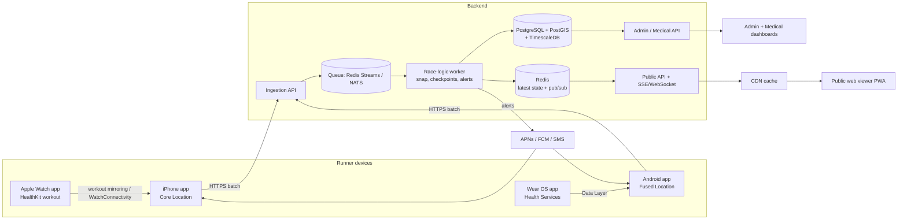

# 01. System Architecture

## 1. Goals

- Show every runner's position on a live map with a few seconds of delay.
- Use native platform APIs for the most accurate position, time, and heart-rate data.
- Survive poor mobile coverage on trails (buffer, then back-fill).
- Support thousands of spectators without slowing down runner data ingestion.
- Keep health data private and consent-driven.

## 2. High-level diagram

## 3. Components

| Component | Responsibility | Tech |
|---|---|---|
| iOS app | Collect GPS, receive watch heart rate, buffer, upload, SOS | Swift, SwiftUI, Core Location, HealthKit, WatchConnectivity |
| watchOS app | Run workout session, measure heart rate, mirror to phone | Swift, HealthKit, WatchKit |
| Android app | Collect GPS in a foreground service, buffer, upload, SOS | Kotlin, Jetpack Compose, Fused Location, Room, WorkManager |
| Wear OS app | Exercise session with heart rate, forward to phone | Kotlin, Health Services, Wearable Data Layer |
| Ingestion API | Authenticate, validate, de-duplicate, enqueue batches | Go or Node.js (Fastify) |
| Race-logic worker | Snap to route, detect checkpoints, compute pace/ETA, evaluate alerts | Same language as API |
| Database | Durable storage, spatial queries, time series | PostgreSQL + PostGIS + TimescaleDB |
| Redis | Latest position per runner, pub/sub, rate limiting | Redis 7 |
| Public API / realtime | Snapshot + live stream for spectators | SSE (preferred) or WebSocket |
| Web viewer | Map, filters, weather, elevation profile | TypeScript, MapLibre GL JS, Vite, PWA |
| Admin / medical dashboards | Event setup, runner management, health monitoring | Same web stack, role-based access |
| Notifications | SOS acknowledgement, race messages, medical alerts | APNs, FCM, optional SMS gateway |

## 4. Data flow

### 4.1 Position path
1. Phone gets a GNSS fix (lat, lon, altitude, accuracy, speed, course, **fix time**).
2. App writes the sample to the local database with a sequence number.
3. Uploader sends unsent samples in a batch (every 10-30 s when online).
4. Ingestion API authenticates the runner token, validates, drops duplicates, and enqueues.
5. Worker snaps the position to the route, updates progress, checks checkpoint geofences, stores the result, and updates Redis.
6. Redis publishes an update. Public API pushes it to connected viewers; the CDN serves the cached snapshot to everyone else.

### 4.2 Heart-rate path
1. Watch runs a workout session and produces heart rate roughly every few seconds.
2. Watch forwards samples to the phone (mirrored workout session on Apple; Data Layer on Wear OS).
3. Phone attaches the samples to the telemetry batch as a separate `heartRate` array with their own timestamps.
4. Backend stores heart rate in its own table, evaluates alert rules, and exposes it **only** to authorized roles (see `06-heart-rate-privacy-consent.md`).

### 4.3 SOS path
Runner taps SOS, which immediately sends `POST /v1/sos` with the latest position (bypassing the batch queue), triggers a medical-dashboard alert, and returns an acknowledgement shown in the app.

## 5. Time handling

- **Sample time** is the GNSS fix time from the OS: `CLLocation.timestamp` on iOS, `Location.time` (UTC ms) on Android. Heart-rate samples carry their own start/end timestamps from HealthKit or Health Services.
- The app also records a monotonic clock value (`Location.elapsedRealtimeNanos` on Android, system uptime on iOS) to detect device clock changes.
- Every API response includes the server time. The app keeps the offset only for display and sanity checks (rejecting samples dated in the future or before the event started). It never rewrites sample timestamps.
- The backend stores both `ts` (sample time) and `received_at` (server time). Ordering and calculations use `ts`. Latency monitoring uses `received_at - ts`.

## 6. Reliability design

| Risk | Mitigation |
|---|---|
| No signal on trail | Local buffer; batched back-fill; server accepts out-of-order data |
| App killed by OS | iOS: location background mode + significant-change relaunch. Android: foreground service + restart job |
| Duplicate uploads | Idempotency key per sample (`runnerId + deviceId + seq`) |
| Phone battery drain | Server-driven adaptive intervals, low-power mode, battery shown in admin |
| Server spike (race start, many viewers) | Ingestion separate from public API; CDN-cached snapshot; SSE fan-out via Redis |
| Spoofed location | OS mock-location flags, impossible-speed filter, route and checkpoint plausibility checks |
| Phone dies | Checkpoint QR/NFC scan as backup; "last seen" age shown on the map |

## 7. Security

- Enrollment: bib + one-time code gives a short-lived access token and refresh token, bound to one device.
- Device integrity: Apple **App Attest** (DeviceCheck) and Android **Play Integrity API** at enrollment and periodically.
- Tokens stored in iOS Keychain and Android Keystore-backed encrypted storage.
- TLS everywhere; certificate pinning optional.
- Role-based access: `public`, `runner`, `organizer`, `medical`, `admin`.
- Health data encrypted at rest (disk + column-level for heart rate) with an audit log of every read by staff.

## 8. Deployment

**Starter (up to roughly 2,000 runners / 20,000 spectators):**
- 1 app VPS (4 vCPU, 8 GB): API, worker, Redis
- 1 managed PostgreSQL (with PostGIS/Timescale)
- Cloudflare (or other CDN) in front of the public API and web app
- Object storage for GPX files, sponsor images, static assets

**Scale-out path:** split ingestion and public API into separate services, run multiple workers consuming the queue, add read replicas, and put snapshots on the CDN with 3-5 s TTL.

**Environments:** `dev` (simulator runners), `staging` (field tests), `prod` (per event, can be torn down after).

## 9. Observability

- Metrics: samples/second, ingest-to-map latency (p50/p95), batch rejection rate, active runners, runners "silent" > N minutes, battery distribution.
- Logs: structured, per runner ID, with PII minimized.
- Alerts to the dev/ops team: queue depth, DB lag, ingestion errors.
- A **replay simulator** (feeds a GPX as fake runners) is part of the system for load and UI testing.
