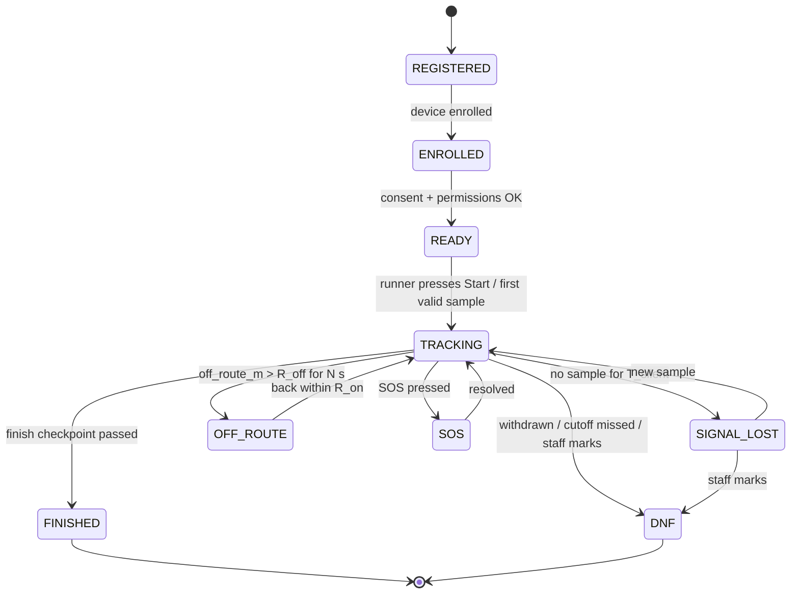

# 05. Race Logic

The rules and algorithms that turn raw positions into race data: clean tracks, route progress, checkpoints, pace, ETA, rankings, and runner state.

## 1. Runner state machine



Each state change is stored with a timestamp and reason. Public pages show a simplified status (Running, Finished, DNF, Not started, No signal).

## 2. Sample quality filter

Applied per sample in the worker (clients upload everything; the server decides).

| Rule | Default | Action |
|---|---|---|
| `hAcc` missing or < 0 | n/a | quality = rejected |
| `hAcc` > 50 m | configurable | quality = low accuracy (keep, do not use for checkpoints) |
| `ts` more than 5 min in the future | n/a | rejected |
| Duplicate `(runner, ts, seq)` | n/a | drop |
| `mock = true` | n/a | quality = suspect; raise an integrity alert; do not use for rankings |
| Implied speed between consecutive accepted points > 7 m/s sustained on trail (configurable) | 7 m/s | quality = suspect |
| Jump: distance > 200 m with `Δt` < 5 s | configurable | quality = suspect |

Suspect samples stay in the database (audit) but are excluded from the live map and calculations until later samples confirm them.

**Smoothing (display only):** apply a light Kalman or moving-average filter to the snapped route distance rather than lat/lon, so markers do not jitter. Keep raw points unchanged in storage.

## 3. Route snapping

Goal: find where on the route the runner is (`route_dist_m`) and how far off it (`off_route_m`).

**Algorithm (windowed snapping):**
1. Preload the route as a polyline with cumulative distance at each vertex.
2. For a new sample, search only a **window** around the runner's last progress: `[last - 200 m, last + 2 km]`. This avoids snapping to a different part of an out-and-back or looping route.
3. For each segment in the window, project the point onto the segment (in a local metric projection such as UTM zone 48S for Java, or use PostGIS `ST_LineLocatePoint` on a geography-aware transform).
4. Choose the segment with the smallest perpendicular distance, subject to **monotonic progress** with limited backtracking (allow up to ~50 m backward for GPS noise).
5. `route_dist_m = cumulative_at_segment_start + projection_distance`; `off_route_m = perpendicular distance`.
6. If no segment within the window is within `R_off` (e.g. 60 m), run a **global search** over the whole route to re-acquire; flag `OFF_ROUTE` if still far away.

Pseudo-code:

```text
function snap(sample, runner):
    lo = max(0, runner.progress - 200)
    hi = min(route.length, runner.progress + 2000)
    best = argmin over segments in [lo, hi] of perpDistance(sample, segment)
    if best.distance > R_off:
        best = argmin over all segments of perpDistance(sample, segment)
    progress = best.cumStart + best.alongDistance
    if progress < runner.progress - 50:       # implausible large backward move
        progress = runner.progress            # hold, mark suspect
    return progress, best.distance
```

Loop and out-and-back routes (common in ultras) need the window approach; they are the reason a plain "nearest point on the whole line" method fails.

## 4. Progress, pace, and speed

- **Distance covered** = latest accepted `route_dist_m`.
- **Moving speed** = Δ`route_dist_m` / Δt over a rolling window (e.g. 2 min), excluding stopped intervals.
- **Pace** = 1000 / speed, shown as min/km.
- **Average pace** = elapsed moving time / distance, and **overall pace** including stops.
- **Elapsed time** = `ts` of latest sample minus the runner's official start time (gun time or chip/first-movement time, per event rule).
- **Ascent/descent** = computed from route elevation profile between start and current `route_dist_m` (more reliable than raw GPS altitude).
- **Grade-adjusted pace (optional)** = adjust by the route gradient so mountain sections are comparable.

## 5. Checkpoints

**Detection:**
1. For each checkpoint on the runner's route, if `route_dist_m` crosses the checkpoint's `route_dist_m` (previous < cp ≤ current), record a pass.
2. Interpolate the pass time between the two samples: `t = t1 + (cp - d1)/(d2 - d1) * (t2 - t1)`.
3. Require the sample to be within the geofence (`radius_m`, e.g. 40 m) **or** `off_route_m` small enough, to avoid counting a pass when the runner took a shortcut that skipped the checkpoint.
4. Ignore `quality >= suspect` samples.
5. Mark `method = gps`. Staff or QR/NFC scans can add or override a pass (`manual` / `scan`), which has priority.

**Mandatory checkpoint compliance:** a runner who skips a mandatory checkpoint is flagged for review (`missed_checkpoint` alert), not automatically disqualified.

**Cut-offs:** each checkpoint may have `cutoff_at`. The worker raises a `cutoff_risk` alert when the ETA exceeds the cut-off by a margin, and a `cutoff_missed` alert after the time passes.

**Splits:** stored per runner per checkpoint (time of day, elapsed, split from the previous checkpoint, rank at checkpoint).

## 6. ETA

For each runner and each upcoming checkpoint or the finish:

```text
remaining = checkpoint.route_dist - runner.route_dist
pace_est  = blend(recent_moving_pace, avg_pace, terrain_factor)
eta       = now_sample_time + remaining * pace_est + expected_rest_time
```

- Use a weighted mix: 60% recent 10-minute pace, 40% overall average, adjusted by the **gradient profile** of the remaining route (slower uphill, faster downhill) using a standard grade-adjustment curve.
- Fatigue factor optional: increase pace estimate slightly with distance for ultras.
- When the runner is `SIGNAL_LOST`, keep the previous ETA and label it "estimated".
- Round to the minute; show a range on the admin side (`eta ± confidence`).

## 7. Rankings

- **Overall and category rank at checkpoint k** = order by checkpoint pass time among runners who passed k.
- **Current live rank** = order by `route_dist_m` among runners on the same route and start wave, using elapsed-time adjustment for staggered starts (rank by projected time to the next checkpoint when waves differ).
- Update ranking every 10-15 seconds (not on every sample) to limit churn.
- Only count samples that pass the quality filter and are not `mock`.

## 8. Silent / lost-signal logic

| Condition | Threshold (configurable) | Action |
|---|---|---|
| No sample received | `T_silent` = 5 min | State `SIGNAL_LOST`, label "last seen X min ago" on the map |
| Silent in a known dead zone | per-route list of dead-zone ranges | Suppress alert until `T_silent_dead` (e.g. 30 min) |
| Silent past a checkpoint where it should have reported | ETA + margin | Alert to staff |
| Silent and last speed ~0 | | Raise priority (possible fall or injury) |

Back-filled data after reconnecting updates history and recalculates derived values for the gap. The live map marker jumps to the newest data; the track line fills in.

## 9. Stationary and off-route alerts

- **Stationary:** moving speed < 0.3 m/s for more than N minutes (default 10) outside a checkpoint or aid station geofence. Staff alert at `warn`; combined with heart-rate anomaly at `critical` (doc 06).
- **Off route:** `off_route_m > 60 m` for more than 60 s. Notify the runner via push and alert staff. Clear when within 30 m for 30 s (hysteresis).
- **Wrong direction:** progress decreasing for > 200 m. Alert.
- **Weather-linked (optional):** if the event declares a weather hold, show a banner and send pushes to runners.

## 10. Finish and results

- Finish is recorded when the runner passes the finish checkpoint (GPS) or staff scan.
- Runner state becomes `FINISHED`; the app receives the state, stops tracking, and shows a summary.
- Official results come from the event's timing source if different. The tracking system's times are marked "live/unofficial" unless the organizer chooses to publish them as official.

## 11. Testing the logic

- Feed recorded GPX runs with added noise, dropouts, and duplicated points
- Loop and out-and-back test routes
- Two runners crossing paths on different routes
- Late back-fill of a 20-minute gap: verify state, ranks, and splits are corrected
- Staggered starts: check live rank and elapsed time
- Fuzz test: random `hAcc`, speed, and time jumps
